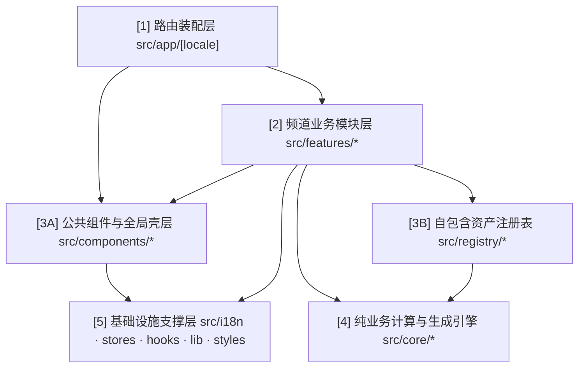
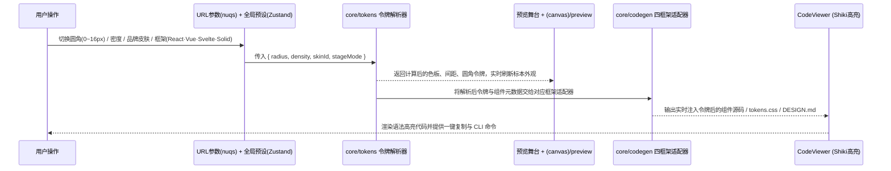

# 架构设计

- **状态**：已定稿
- **最近更新**：2026-11-27
- **上游文档**：[技术设计](./技术设计.md)
- **下游文档**：[前端设计](./前端设计.md) · [项目路线图](./roadmap.md)

## 1. 系统总体架构图

### 节点说明
1. **`[1]` 路由装配层（`src/app/[locale]`）**：负责解析 URL 路径参数（`locale`、`category`、`slug`、`studio`）、生成页面 SEO 元信息，并将主站分组 `(site)` 与纯净预览画布分组 `(canvas)` 分流，单文件仅做薄壳组装。
2. **`[2]` 频道业务模块层（`src/features/*`）**：按首页、设计图鉴、设计风格、组件库、模板（整站工程 + 单页模板）、参数工具箱（背景 / 阴影 / 配色 / 排版）、接入到AI 七大业务域拆分独立视图与客户端交互逻辑。
3. **`[3A]` 公共组件与全局壳层（`src/components/*`）**：向下沉淀全站统一的设计系统原子控件（按钮、徽章、双色微色块、分段器、弹窗等）、跨频道组合块（统一横幅、Shiki 代码框、视口画框）以及顶部 6 频道四列短词抽屉菜单与 `⌘K` 全局面板。
4. **`[3B]` 自包含资产注册表（`src/registry/*`）**：按「一资产一目录」存储品牌 `DESIGN.md` 数据、10 套通用 UI 风格流派、三大类 21 组局部组件标本（Section / Block / Motion）、12 套整站与单页模板、工具预设及 5 类 MCP 客户端配置。
5. **`[4]` 纯业务计算与生成引擎（`src/core/*`）**：完全不依赖 React 与浏览器 DOM 的纯 TypeScript 子包，负责设计令牌合成、品牌与流派 `DESIGN.md` 协议编译、React + Tailwind 组件源码输出、背景/阴影/色阶对比度/模块化字号数学换算及全站检索匹配。
6. **`[5]` 基础设施支撑层（`src/i18n` · `stores` · `hooks` · `lib` · `styles`）**：提供双语分片词条、Zustand 本地持久化预设、剪贴板/下载 Hooks、Shiki 高亮封装与明暗双主题 CSS 变量。

## 2. 架构分层与单向依赖规则

| 层级 | 对应代码目录 | 核心模块文档 | 核心职责 | 允许依赖的目标层 |
| :--- | :--- | :--- | :--- | :--- |
| **路由装配层** | `src/app/`、`src/middleware.ts` | [多语言与全局导航壳层](./模块设计/多语言与全局导航壳层.md) | 多语言路由分发、Layout 壳层挂载、动态路由参数校验与 404 兜底 | 频道业务模块层、公共组件层、资产注册表、基础设施层 |
| **频道业务层** | `src/features/` | [首页与图鉴模板频道](./模块设计/首页与图鉴模板频道.md)、[设计风格与换肤对比台](./模块设计/设计风格与换肤对比台.md)、[组件库与三栏实时工作台](./模块设计/组件库与三栏实时工作台.md)、[参数实验室与MCP沙盒](./模块设计/参数实验室与MCP沙盒.md) | 各业务频道的筛选联动、换肤对比、工作台三栏协调、实时调参预览与协议导出交互 | 公共组件层、资产注册表、纯业务引擎层、基础设施层 |
| **公共组件层** | `src/components/` | [设计系统与样式令牌](./模块设计/设计系统与样式令牌.md)、[多语言与全局导航壳层](./模块设计/多语言与全局导航壳层.md) | 原子级 UI 原语、跨频道组合模式块、全站吸顶导航与全局弹层 | 资产注册表（仅导航菜单索引与搜索）、纯业务引擎层、基础设施层 |
| **资产注册表层** | `src/registry/` | [自包含资产注册表](./模块设计/自包含资产注册表.md) | 自包含存储品牌规范、组件预览标本、整站模板、工具预设与分类目录索引 | 纯业务引擎层的类型定义、基础设施样式工具 |
| **纯业务引擎层** | `src/core/` | [核心计算与生成引擎](./模块设计/核心计算与生成引擎.md) | 令牌解析、`DESIGN.md` 编译、多框架代码适配生成、工具数学换算、搜索匹配 | 仅可依赖同层子包或资产数据结构契约，禁止依赖 React / Next.js |
| **基础设施层** | `src/styles/`、`src/i18n/`、`src/stores/`、`src/hooks/`、`src/lib/` | [设计系统与样式令牌](./模块设计/设计系统与样式令牌.md) | CSS 变量令牌、本地化字体、翻译加载、持久化 Store、Shiki 与通用工具 | 第三方基础库与纯业务引擎类型 |

## 3. 核心业务主流程

### 3.1 组件三栏实时工作台调参与多框架代码导出链路

### 3.2 跨频道品牌规范一键带入工作台链路
用户在「设计图鉴详情页（`/catalog/linear`）」或「整站模板页（`/templates`）」点击「在组件工作台中套用该规范」时，系统将选中品牌的 `skinId` 与默认圆角写入全局 `workbench-preset` Store 并跳转至组件工作台路由，实现「看中标杆设计 → 套用到具体组件 → 导出目标框架源码」的闭环。

## 4. 异常隔离与状态恢复机制

1. **路由参数越界兜底**：访问不存在的品牌 `slug`、组件分类或资产路径时，统一触发 Next.js `notFound()` 渲染多语言 404 引导页，避免空指针白屏。
2. **本地持久化容错**：`zustand` 持久化读取 `localStorage` 时做字段合法性兜底，若浏览器禁用存储或旧版缓存字段变更，自动回退至默认预设（`radius: 4`、`density: "default"`、`skin: "linear"`）。
3. **筛选零结果恢复**：图鉴、组件库、模板与 `⌘K` 搜索在无匹配条目时，统一渲染带「清空筛选条件」一键恢复按钮的空状态面板。
4. **预览舞台样式隔离**：组件预览容器限定在独立局部变量作用域或 `(canvas)/preview` 同源画布路由内，动态修改舞台明暗或品牌色板不会污染外层站点顶栏与侧栏。

## 5. 自包含卡槽插拔与规模化批量生产架构

全站严格拆分为 **「展馆展示壳层（`src/features/*`）」** 与 **「自包含展品卡槽（`src/registry/*`）」** 两层：壳层只负责路由、筛选、视口框、代码高亮与协议导出，绝不在壳层写死具体展品界面；具体资产由独立会话按 `docs/资产扩充/` 待办清单与 `.agents/skills/` 生产流水线逐盒精雕后自动挂载：

| 资产大类 | 独立卡槽路径 | 卡槽自包含文件契约 | 自动汇总与质检 Skill |
| :--- | :--- | :--- | :--- |
| **01 设计图鉴** | `src/registry/catalog/websites/<id>/` + `public/catalog/<id>/` | `index.ts` + `scraped.ts` + 双端截图 | `uifino-catalog-harvester` |
| **02 设计风格** | `src/registry/styles/<slug>/` | `index.ts`（双色板与护栏）+ `showcase.tsx`（流派专属高定样板画卷）+ `thumbnail.tsx`（专属列表封面） | `uifino-style-crafter` |
| **03 组件库** | `src/registry/components/<大类>/<分类>/<slug>/` | `meta.ts`（参数与双语护栏）+ `component.tsx`（真纯组件源码）+ `demo.tsx`（多态演示）+ `source.ts`（源码原文包） | `uifino-component-crafter` |
| **04 模板** | `src/registry/templates/<slug>/` | `meta.ts`（路由与积木清单）+ `sandbox.tsx`（多路由真实交互视图）+ `thumbnail.tsx`（专属封面） | `uifino-template-crafter` |
| **工具与 MCP** | `src/core/studios/*`、`src/app/api/mcp/`、`src/app/r/` | 五大纯逻辑计算子包 + 在线 MCP 端点 + 兼容 `shadcn` 静态注册表路由 | 直接复用 `core/` 与 `registry/` |
